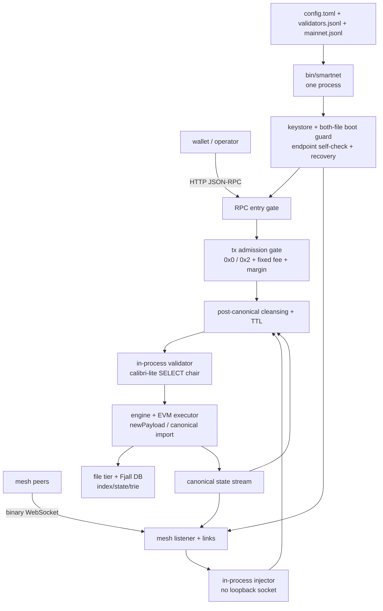

# SmartNet Architecture

> **STATUS: CURRENT — 2026-11-24**
>
> This page describes the shipped architecture. Design-only quorum work is labelled as such and must not be read as current runtime behavior.
> For decision rationale, see [`DESIGN-DECISIONS.md`](DESIGN-DECISIONS.md). For doc authority and freshness, see [`DOC-INDEX.md`](DOC-INDEX.md).

## 1. What SmartNet is

SmartNet is a **separate, private/open EVM-compatible execution network** derived from Ethereum code lineages but not committed to Ethereum legacy. It is a single-binary client for rapid deployment of a fast, secure private EVM/DeFi network.

It deliberately supports a subset of the EVM:

- native coin transfers,
- ERC-20,
- contract deployment,
- basic DeFi,
- `eth_*` JSON-RPC over HTTP for wallets such as MetaMask.

It is **not Ethereum mainnet/testnet compatible**. It has no P2P/KAD, no Ethereum fork/city-gate legacy, no JWT/auth RPC, no WebSocket JSON-RPC, and no MDBX/RocksDB. The codebase is heavily modified Reth v2.1 lineage, but it is not a Reth fork in behavior or roadmap.

Problem statement: run a small, closed, predictable network where operators control the node set, the native coin fee is fixed, and the execution environment remains familiar to Solidity/ERC-20 tooling without inheriting Ethereum networking and governance baggage.

## 2. System boundary

| In scope now | Out of scope by design |
| --- | --- |
| Single binary with engine, RPC, mesh, and in-process validator | Ethereum P2P, KAD, NAT traversal |
| HTTP JSON-RPC only | WebSocket JSON-RPC / auth-secure RPC / JWT |
| Binary WebSocket Mesh protocol | Generic Ethereum discovery or peer scoring |
| Closed-list bootstrap files (`validators.jsonl`, `mainnet.jsonl`) | On-chain `validators.jsonl` governance |
| Fixed native coin fee; ERC-20 fee market untouched | Ethereum base-fee/fork economy |
| File tier + Fjall storage | MDBX, RocksDB |
| Mars-only mixed rulebook | Istanbul/London/other city gates as network forks |

The node set comes from operator config and the two bootstrap files. Both files must be present and loaded before boot proceeds. `config.toml` is the single source of truth for operational keys; the files do not override it.

## 3. Five-minute diagram

The important branch is that the validator does **not** talk to a separate process over RPC. It reads the local pool, builds/seals locally, and submits the sealed RLP to the in-process engine. Mesh injection also uses in-process objects: transactions go through the same `EthApi::send_raw_transaction` handler, and blocks through the engine `new_payload` handler.

## 4. Startup sequence

1. **CLI and config.** `bin/smartnet` parses the command and loads one shared `config.toml`. The mesh is always on; HTTP RPC is optional.
2. **Bootstrap guard.** Keystore is checked, then both `validators.jsonl` and `mainnet.jsonl` must be present and loaded. A missing file is a hard boot error.
3. **Endpoint self-check.** The node derives its address from the keystore, finds its own `mainnet.jsonl` record, and requires `MESH_ADDR`/`MESH_PORT` to match the record's `ip`/`port_range`. Neither side is authoritative; mismatch is an error. No defaults or hardcoded loopback/port fallback exist.
4. **Recovery.** `recover_on_boot` decides whether a crash unwind is required. A clean marker from the previous shutdown skips rewind. The `final_protocol` task is registered immediately after recovery so later boot errors still run the full shutdown sequence.
5. **Components.** Provider, txpool, engine, RPC modules, validator, and mesh are attached.
6. **Mesh preconnect.** All peer-file targets are dialed once at boot; the config-hash gate runs after HELLO on outbound links.
7. **Sync gate.** RPC transport binds only after mesh catch-up or the boot timeout.

Both bootstrap files are hashed as raw disk bytes by `get_real_file_hash()` on every config-gate check. The digest is never cached. No file is written, synced, or pushed by the gate.

## 5. Runtime flows

### 5.1 Transaction flow

1. Wallet submits via HTTP JSON-RPC, or a peer announces a transaction over Mesh.
2. The shared submit gate applies the funded-wallet/min-balance check, the MARS transaction-type gate (`0x0` and `0x2` only), and the optional `TXPOOL_MARGIN` admission filter.
3. Accepted transactions enter the txpool.
4. The validator reads a capped pool snapshot. `TXPOOL_VAL_MAX_TXS` is the validator pick count; the node still serves the full pool.
5. Chain ID is enforced before sealing.

Mesh and wallet transactions both arrive as `External` through `eth_sendRawTransaction`; see [`ORIGIN.md`](ORIGIN.md).

### 5.2 Seal and EVM execution

1. When `SEAL = true`, the in-process validator waits for its SELECT chair turn.
2. It checks chain ID, head, enabled validator registry, and signer authorization.
3. It selects from the local txpool, builds the header, validates the proposal, and signs one seal.
4. The sealed RLP goes to the engine through `new_payload`; the payload validator executes transactions through `ConfigureEvm`/executor.
5. Only a `VALID` result is committed; txpool cleansing happens after canonical acceptance, not at proposal time. See [`TXPOOL-CLENSING-ON-BLOCK-PROP-ACCEPT.md`](TXPOOL-CLENSING-ON-BLOCK-PROP-ACCEPT.md).

EVM/executor, smart-contract core, ERC-20 behavior/fees, DeFi V2, `eth_*` RPC names, tx types `0x0`/`0x2`, and MetaMask behavior are frozen invariants of this architecture.

### 5.3 Mesh flow

Mesh is a closed-list, all-to-all binary WebSocket protocol. Every connection starts with signed HELLO identity; outbound links then run the config-hash gate before sync or gossip.

- **Blocks:** canonical state stream → RLP announce → peer fetch/ordered pull → in-process engine injection.
- **Transactions:** pool event → EIP-2718 bytes → announce → peer request/response → in-process `eth_sendRawTransaction`.
- **Sync:** one full block per `SYNC_BLOCK_RLP_PONG`; announcements are pipelined, block fetches are serialized.
- **Failure handling:** HELLO/list failures are per-connection; config-hash mismatch marks the peer rejected in memory for the process lifetime.

Wire details are normative in [`MESH-PAYLOAD-PROTOCOL.md`](MESH-PAYLOAD-PROTOCOL.md).

### 5.4 Storage and recovery

`StorageEngine` owns the file tier and Fjall stores. Its write order is: extract records → FS append (page cache) → DB index/state/trie + deferred finalized/safe + changeset-window trim → one `SyncData` commit; sealed shards are fsynced by background seal tasks.

On graceful shutdown (success, command error or ctrl+c) the runtime signal reaches `final_protocol`, which waits until every other started graceful action has finalized — consensus engine `Terminate`/tree persistence and the txpool backup task — then flushes the file tier and writes `SHUTDOWN_CLEAN` (flag + timestamp) **last**. The runtime is dropped only after that; a timeout leaves no marker and the next boot unwinds. On boot, that marker skips the 2-line unwind. A hard crash leaves the marker absent and recovery trims the uncommitted tail. Errors from `NodeCommand::execute` onward get runner graceful shutdown; earlier CLI validation errors occur before the runner and before `final_protocol` exists, so they cannot write a clean marker. See [`BOOTSTRAP.md`](BOOTSTRAP.md).

Fees are documented in [`FEES-CURR.md`](FEES-CURR.md). Native transfers use one configured fixed price; ERC-20/DeFi keep ordinary `gasUsed × gasPrice` behavior with no contract special-casing.

## 6. Component map

| Component | Role | Current anchor |
| --- | --- | --- |
| `bin/smartnet` | One process entry point; launches node and waits for exit | `smartnet/bin/smartnet/src/main.rs` |
| CLI boot guard | Config, keystore, both files, self endpoint check, chain identity | `smartnet/crates/node/cli/src/app.rs`, `smartnet/crates/node/ethereum/src/bootstrap_files.rs` |
| Engine launcher | Recovery, marker, pipeline, engine task, add-ons, RPC bind gate | `smartnet/crates/node/builder/src/launch/engine.rs` |
| HTTP RPC | Wallet-facing `eth_*` API; tx entry gate; no WS JSON-RPC | `smartnet/crates/rpc/...` |
| Txpool | Full node pool, TTL, margin filter, validator pick cap | `smartnet/crates/txpool/...`, [`ORIGIN.md`](ORIGIN.md) |
| Validator | In-process seal loop, SELECT chair, chain-ID and signer checks | `smartnet/crates/node/validator/...`, `calibri-lite/calibri-lite-consensus/...` |
| Engine/EVM | `new_payload`, executor, canonical import, persistence | `smartnet/crates/engine/tree/...`, `smartnet/crates/evm/...` |
| Mesh | Binary WS listener, identity, config gate, sync, rumor/inject | `smartnet/crates/net/mesh/...`, [`MESH-PAYLOAD-PROTOCOL.md`](MESH-PAYLOAD-PROTOCOL.md) |
| Storage | File tier + Fjall DB, recovery, clean-shutdown marker | `smartnet/crates/storage/provider/src/storage_engine.rs` |

## 7. Reth-derived vs SmartNet-specific

| Reth-derived base | SmartNet-specific replacement or policy |
| --- | --- |
| Layered crates: engine/tree, EVM, RPC, payload, txpool, trie, stages, provider | One node binary with engine + RPC + mesh + in-process validator |
| Ethereum JSON-RPC naming/`eth_*` surface for wallets | HTTP only; WS is binary Mesh, never JSON-RPC |
| Transaction pool and executor concepts | Shared tx entry gate, fixed native fee, `0x0`/`0x2` only |
| Database/provider abstraction | File tier + Fjall; MDBX/RocksDB removed |
| Genesis/chain-spec machinery | Mars-only mixed rulebook; no city forks |
| Engine API concepts | In-process validator submit and engine `new_payload` seam |
| Generic block propagation ideas | Closed-list Mesh with signed HELLO, config-hash gate, raw-file hashes |

This is lineage, not compatibility: the client would fail on real Ethereum testnet/mainnet.

## 8. Removed by design

| Removed | Replacement / current stance | Must not restore |
| --- | --- | --- |
| P2P/KAD, NAT traversal | Closed-list Mesh links | Yes |
| JWT / auth-secure RPC | Mesh identity + HELLO; no auth RPC layer | Yes |
| WebSocket JSON-RPC | Binary WebSocket Mesh only | Yes |
| MDBX / RocksDB | File system + Fjall | Yes |
| Ethereum forks / city gates | Mars-only mixed rules | Yes |
| BOA / js tooling | Rust-only workload tools | Yes |
| On-chain validator governance | Fixed operator files loaded at boot | Yes |

## 9. Consensus reality

Current runtime:

- `INTERIM_QUORUM_THRESHOLD = 1`.
- Authorized validators are loaded from `validators.jsonl`; only `status: true` records participate in chair selection.
- The chair is selected through the current SELECT path; `check_seal` recovers **one** seal signer and verifies it equals the chair.
- There is no multi-signature certificate, no shipped `⌈2k/3⌉` threshold decision path, no minority reports, and no tested 33%/67% behavior.

[`quorum-doc.md`](quorum-doc.md) describes the future chair/quorum/BT design. It is design material, not current block admission.

## 10. Current status map

| Area | Status | Note |
| --- | --- | --- |
| Single binary, HTTP RPC, tx gate, EVM executor, in-process validator | Implemented | Core runtime path |
| Mesh identity, config gate, sync, rumor/inject | Implemented | Normative wire spec in `MESH-PAYLOAD-PROTOCOL.md` |
| Both-file boot guard, endpoint self-check, clean shutdown on boot errors | Implemented | Current boot/recovery behavior |
| Native fixed fee, ERC-20 behavior, DeFi V2, MetaMask surface | Implemented | Frozen invariants |
| Compatibility matrix, public test evidence, security threat model | Under validation / planned | See [`IMP-TODO.md`](../IMP-TODO.md) |
| LITE 3+ validator demo, multi-node CI | Planned | Tests/harness only; no consensus behavior changes |
| Mesh Explorer | Postponed | Separate project |
| Independent audit | Out of scope | Requires docs/evidence first |

## 11. Read next

- [`DOC-INDEX.md`](DOC-INDEX.md) — which doc is authoritative, and which are historical.
- [`DESIGN-DECISIONS.md`](DESIGN-DECISIONS.md) — decisions, trade-offs, and must-not-restore list.
- [`MESH-PAYLOAD-PROTOCOL.md`](MESH-PAYLOAD-PROTOCOL.md) — binary Mesh CURRENT/OLD spec.
- [`FEES-CURR.md`](FEES-CURR.md) — current fee rules.
- [`ORIGIN.md`](ORIGIN.md) — transaction origin labels.
- [`TXPOOL-CLENSING-ON-BLOCK-PROP-ACCEPT.md`](TXPOOL-CLENSING-ON-BLOCK-PROP-ACCEPT.md) — pool lifecycle after canonical accept.
